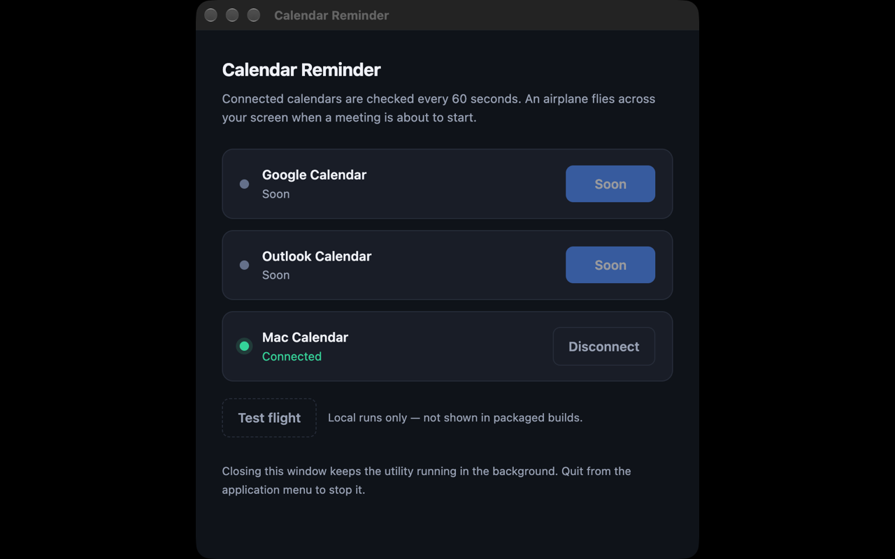
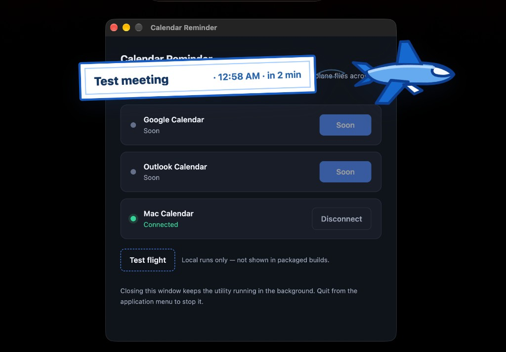

# Calendar Reminder

A small Electron desktop app that watches **Mac Calendar** and flies a reminder airplane across your screen when a meeting starts within two minutes.

Google Calendar and Outlook are shown on the dashboard, but their buttons are disabled (**Soon**). They are not polled.

No backend. Calendar access stays on your computer.

## Screenshots

### Dashboard



### Meeting reminder



---

## What it does

| Behavior | Detail |
|---|---|
| Dashboard | Connect or disconnect Mac Calendar. Google and Outlook stay disabled until they are finished |
| Polling | Every **60 seconds**, asks Mac Calendar for events starting in the next **5 minutes** |
| Alert | If an event starts in **≤ 2 minutes**, a click-through overlay flies an airplane left to right for **12 seconds** |
| Background | Closing the dashboard does not quit the app. Quit from the application menu (macOS: **Calendar Reminder → Quit**) |

Mac Calendar is macOS-only.

---

## Using it

1. Launch the app.
2. Click **Mac Calendar → Connect**.
3. Allow **Full Access** when macOS asks. While running from source the prompt is attributed to **Electron**. A packaged build asks for **Calendar Reminder**.
4. Leave it running. Closing the window keeps it polling.

**Test flight** (source runs only) previews the airplane without a real meeting.

---

## Building

Requirements: **Node.js** 22 or newer, and **macOS** for the Calendar connection. Linux can still be packaged, but it has no Mac Calendar row.

```bash
npm install
npm start
```

`npm start` builds and signs the EventKit helper, then adds Calendar usage strings to the unpackaged Electron app so the permission dialog can appear.

If macOS already denied access and the dialog never returns:

```bash
# unpackaged (npm start)
tccutil reset Calendar com.github.Electron

# packaged app
tccutil reset Calendar com.calendarreminder.app
```

Then click **Connect** again.

Disconnect stops polling. It does not revoke the system permission. Use System Settings → Privacy & Security → Calendars for that.

The opt-in marker lives in the user-data folder:

```text
macOS   ~/Library/Application Support/calendar-reminder/macos_calendar_enabled.json
```

Package installers with:

```bash
npm run dist
```

That writes a macOS `.dmg` and a Linux `.AppImage` under `dist/`.

---

## Google and Outlook

Those rows are intentionally disabled. The OAuth modules are still in the tree (`auth-google.js`, `auth-outlook.js`), but this repository does not ship client credentials. `google_secret.json` and `outlook_secret.json` are gitignored. Do not commit them.

When those providers are turned back on, token refresh on the poll path is not fully covered by the 15 second request timeout. A hung refresh can stall polling until the socket dies. That limit is marked at `REQUEST_TIMEOUT_MS` in `main.js`.

---

## Day-to-day

| Goal | Action |
|---|---|
| Start | `npm start`, or launch the packaged app |
| Connect Mac Calendar | Dashboard → **Connect** |
| Disconnect | Dashboard → **Disconnect** |
| Preview the airplane | Dashboard → **Test flight** (source runs only) |
| Keep watching meetings | Close the window and leave the process running |
| Stop | Application menu → **Quit**, or Cmd+Q |
| Reopen the dashboard | Launch the app again. A second launch focuses the existing one |
| Permission dialog missing | `tccutil reset` for the bundle id above, then **Connect** again |

All-day events are ignored. A meeting that has already started is ignored. The same meeting is not flown again on every poll.

---

## Project layout

```text
package.json          dependencies and electron-builder config
main.js               windows, polling, and the overlay
auth-macos.js         Mac Calendar helper bridge
native/macos-calendar Swift EventKit CLI
config.html           dashboard
animation.html        airplane overlay
auth-google.js        Google OAuth client, not enabled
auth-outlook.js       Outlook OAuth client, not enabled
LICENSE               MIT
```
